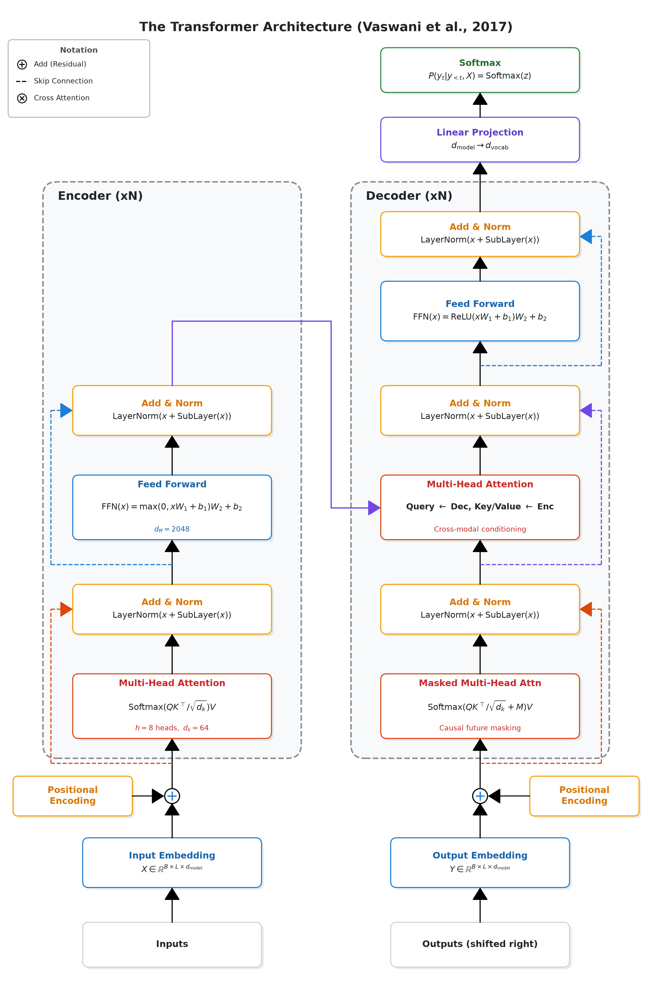
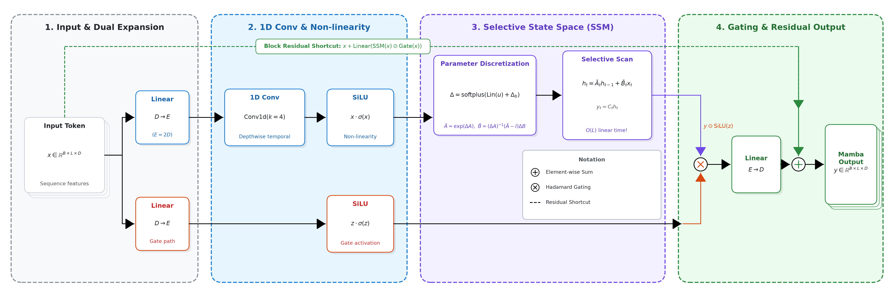

# Matplotlib Flowchart & Architecture Diagram Skill

> Programmatically generate publication-quality deep learning architecture diagrams, module flowcharts, and technical pipeline figures in Python with Matplotlib.

[-blue.svg)](assets/)
[](scripts/engine.py)
[](SKILL.md)
[](#license--usage)

---

## Gallery of Landmark Reference Architectures

All diagrams below are programmatically synthesized via normalized vector geometry using the `FlowchartCanvas` engine:

### 1. Transformer Encoder-Decoder Stack (*Attention Is All You Need*)
*Tall vertical stack layout (`FlowchartCanvas.tall()`), multi-column parallel pathways, scaled dot-product attention routing, residual skips, and layer norms.*



---

### 2. Mamba Selective State Space Block (*Mamba: Linear-Time Sequence Modeling*)
*Wide horizontal pipeline layout (`FlowchartCanvas.wide()`), dual-branch expansion, discretization, 1D convolution, selective scan, Hadamard gating, and residual bypass.*



---

## Key Features

- **Arbitrary Canvas Ratios & Sizing**:
  - `FlowchartCanvas.wide()`: Ideal for horizontal multi-stage pipelines (Mamba, ResNet stages, multi-branch models).
  - `FlowchartCanvas.tall()`: Ideal for vertical stacks (Transformers, deep backbones, autoencoders).
  - `FlowchartCanvas.square()`: Ideal for single module deep-dives (attention heads, gated units, spatial blocks).
  - `FlowchartCanvas(figsize=(W, H), xlim=(0, X), ylim=(0, Y))`: Custom arbitrary dimensions.
- **Theming & Academic Palettes**:
  - `"academic"` / `"academic_light"`: Soft pastel fills with crisp high-contrast text conforming to IEEE, CVPR, NeurIPS, and ACM standards.
  - `"modern_dark"`: Dark canvas with high-contrast glowing accents for presentation decks and web showcases.
  - `"minimal_mono"`: Grayscale styling optimized for physical monochrome printing.
- **Dynamic, Non-Overlapping Placement**:
  - Cards, nodes, arrows, stage titles and stage borders are tracked as obstacles; placement is resolved at `save()` time, so draw order doesn't matter.
  - `label(x, y, text)`: text attached to a node/anchor, moved to the nearest free spot.
  - `path_label(pts, text)`: boxed label that slides along a `poly_arrow` path until it covers nothing.
  - `legend(items=[...], anchor="lower right")`: omit `x`/`y` to auto-pick a free rectangle (explicit `x, y` still works).
  - `text(x, y, s)`: like `ax.text`, but registered as an obstacle. `stage_container(..., title_align="left")` keeps titles clear of arrows.
- **Background Modes** (`background=`):
  - `"theme"` (default): solid canvas color from the theme (white for light themes, dark gray for `"dark"`).
  - `"trans"`: fully transparent background, only the shapes are drawn.
- **Rich Vector Primitives**:
  - `stage_container()`: Grouped functional phases with dashed colored borders.
  - `card()`: Rounded operation cards with realistic drop shadows and multi-card tensor stacking.
  - `pill()`: Compact feature chips with numeric or shape badges.
  - `vertical_block()`: Rotated feature backbone spine blocks.
  - `arrow()` & `poly_arrow()`: Normalized orthogonal routing with proportional arrowheads.
  - `plus_node()` & `times_node()`: Clean mathematical operator nodes ($\oplus$ and $\otimes$).
  - `legend()`: Publication-style floating notation key.
- **Camera-Ready Vector Exports**:
  - Clean vector `.svg` output for infinite scaling and direct conversion to LaTeX PDF.
  - High-resolution `.png` rendered at 300 DPI with tight bounding box cropping.

---

## Directory Structure

```text
matplotlib-flowchart/
├── SKILL.md             # Antigravity Skill specification and prompt guidance
├── README.md            # Repository overview & visual gallery
├── .gitignore           # Git ignore definitions
├── scripts/
│   ├── __init__.py      # Package exports (FlowchartCanvas, THEMES, get_theme)
│   ├── engine.py        # Core vector canvas, layout primitives, and export logic
│   └── color_palettes.py# Curated academic and dark mode palettes
├── examples/
│   ├── example_transformer.py  # Vaswani et al. (2017) Transformer diagram
│   └── example_mamba.py        # Gu & Dao (2023) Mamba SSM block diagram
├── assets/              # Camera-ready vector SVG and 300 DPI PNG outputs
└── references/
    └── style_guide.md   # Typography, layout, and LaTeX inclusion standards
```

---

## Quickstart

```bash
# Clone or navigate to the repository
cd Projects/matplotlib-flowchart

# Run the reference architecture generators
python examples/example_transformer.py
python examples/example_mamba.py

# Generated diagrams are saved to assets/
# assets/example_transformer.png & .svg
# assets/example_mamba.png & .svg
```

### Minimal Custom Diagram Example

```python
from scripts.engine import FlowchartCanvas

# Create a wide canvas with academic theme
canvas = FlowchartCanvas.wide(theme="academic")

# 1. Background Stage Container
canvas.stage_container(5, 5, 40, 22, title="1. Feature Projection", palette="blue")

# 2. Add an Operation Card with Drop Shadow
canvas.card(10, 10, 14, 7, title="Linear", formula=r"$X W_Q + b$", palette="blue", shadow=True)

# 3. Add an Orthogonal Polyline Arrow
canvas.poly_arrow([(24, 13.5), (32, 13.5), (32, 18), (38, 18)], col="#1C7ED6", lw=1.2)

# 4. Save Camera-Ready SVG + PNG
canvas.save("assets", "my_custom_diagram")
```

---

## Antigravity Skill Integration

This repository is structured as a native **Antigravity Skill**. When linked into your Antigravity skills directory (`~/.gemini/config/skills/matplotlib-flowchart`), agents can automatically discover the tool and invoke the engine to synthesize publication figures for any deep learning or engineering problem.

---

## License & Usage

Created for academic researchers, machine learning practitioners, and technical authors aiming for publication-grade illustrations in conferences and journals (NeurIPS, ICML, ICLR, CVPR, ICCV, IEEE TPAMI, ACM, etc.).
Released under the MIT License.
